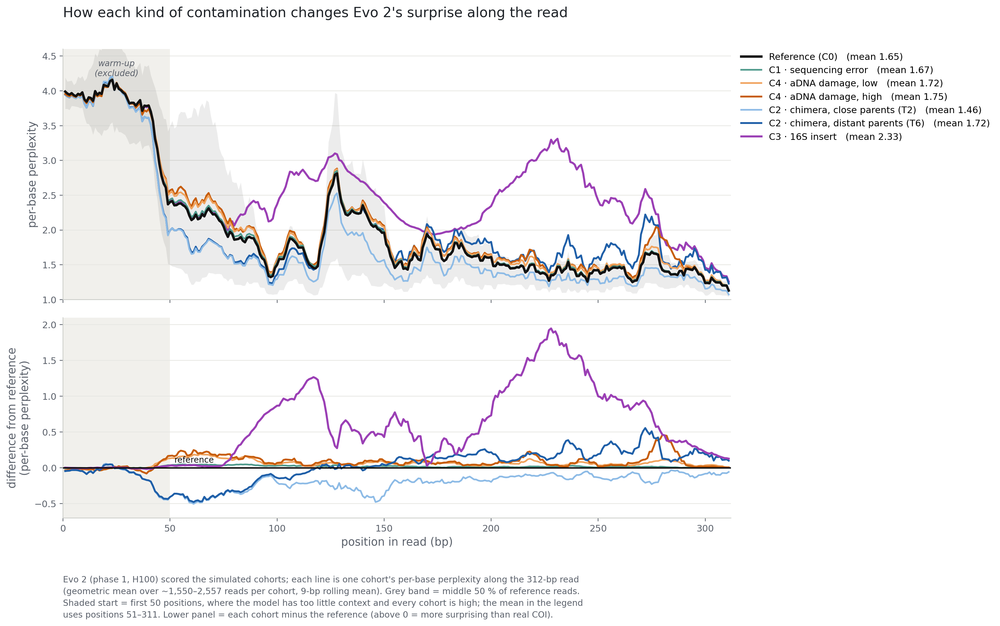
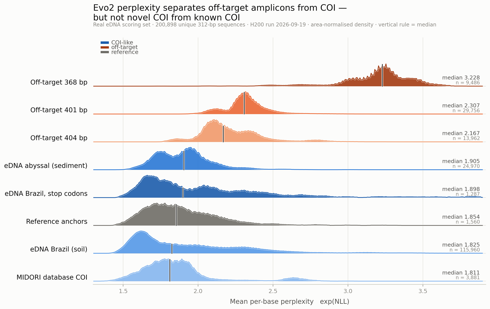
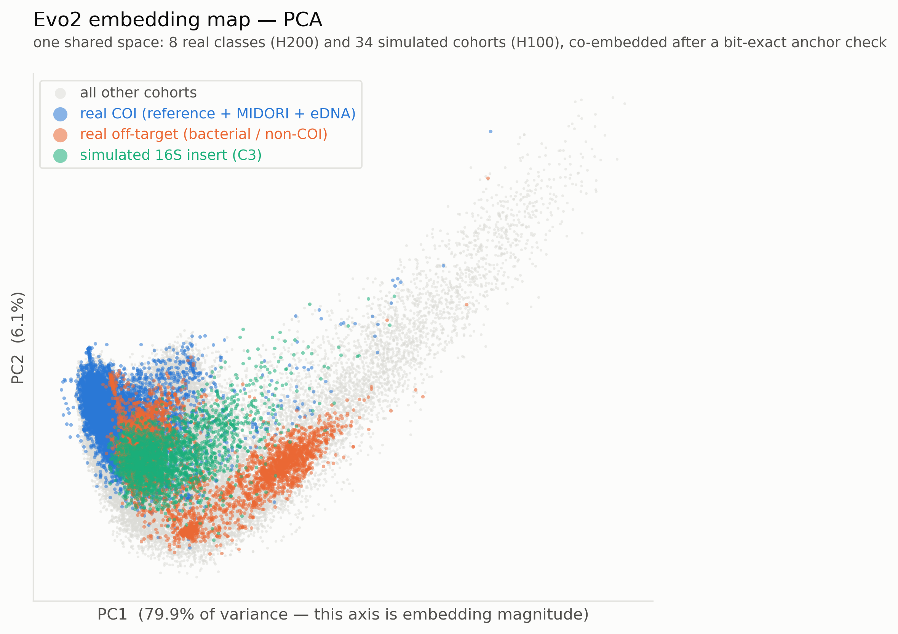
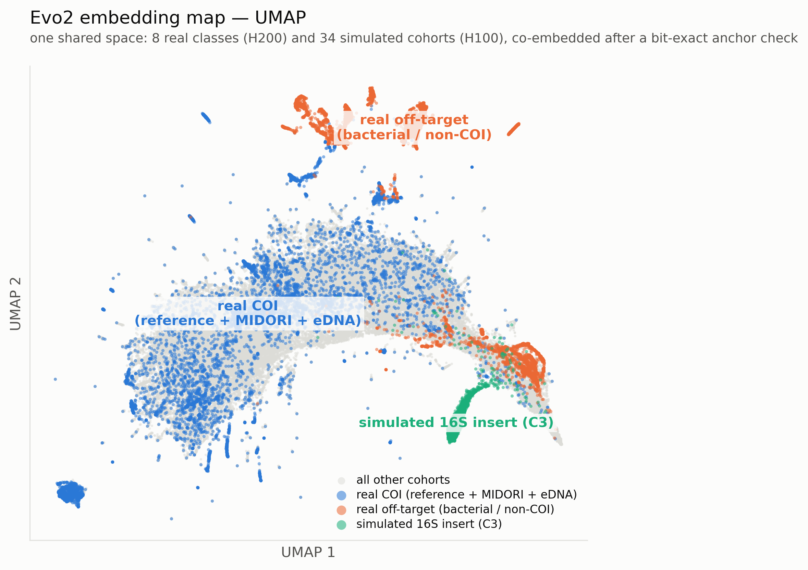
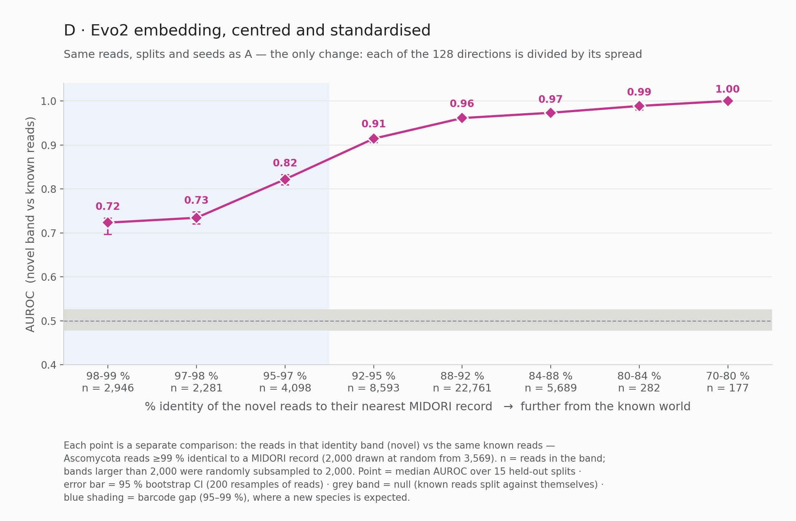
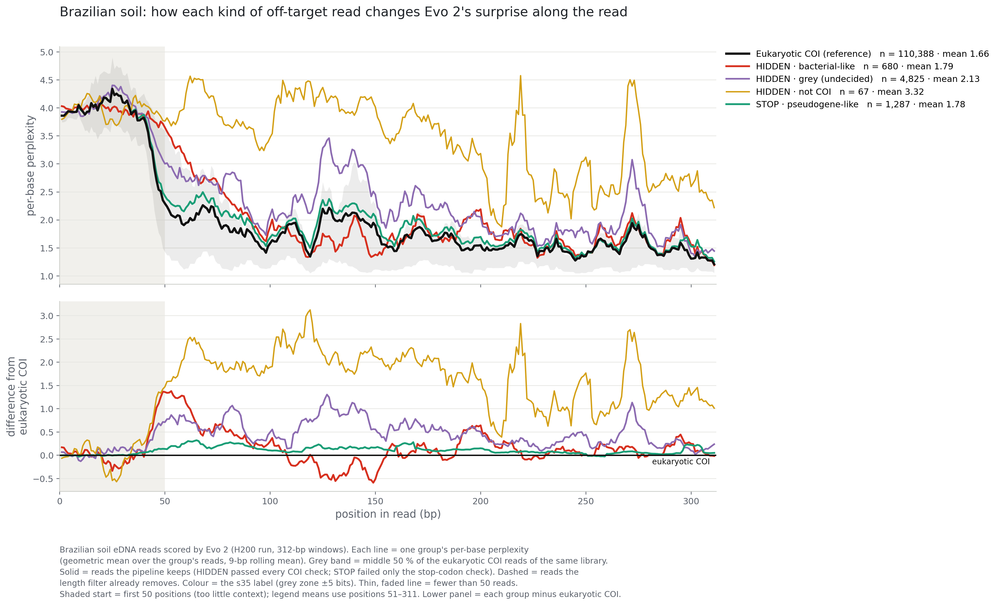
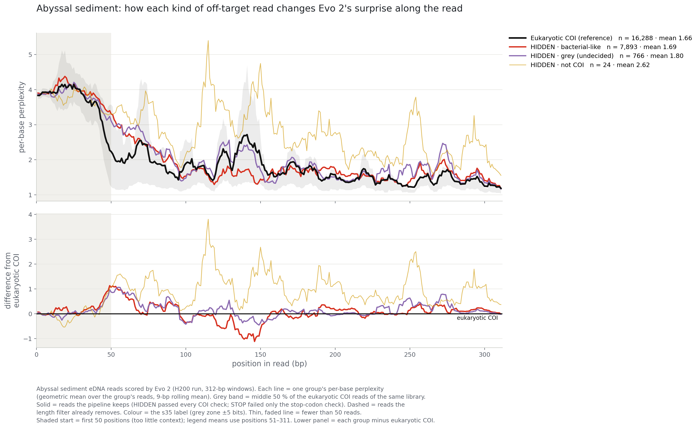
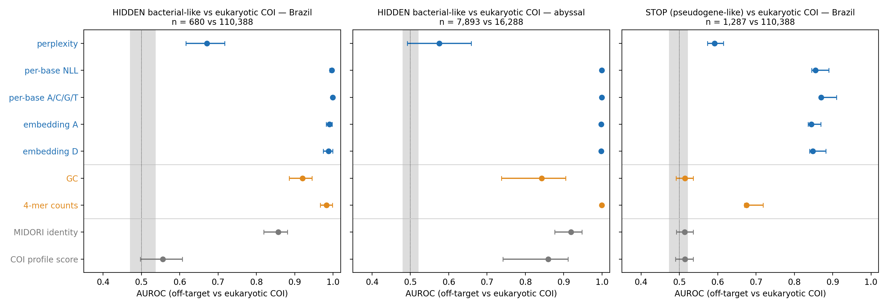
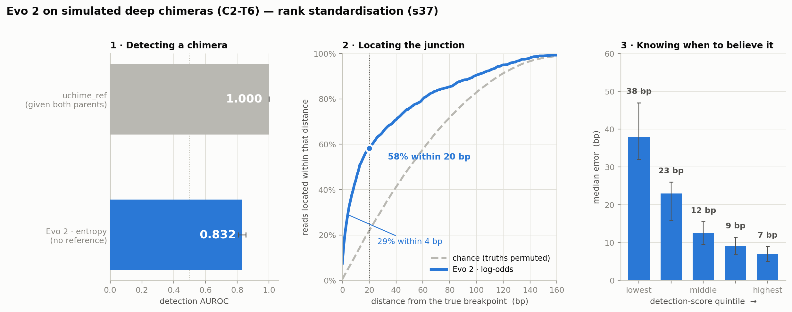

# What a DNA language model knows about real eDNA reads — off-targets, novelty and chimeras

**Version 2 · October 2026 · real environmental DNA.**
The first version of this project (August 2026, simulated data only, per-base perplexity + a small
neural network) is kept unchanged in its own repository:
**[maiakaplan03/evo2-edna-novelty-v1](https://github.com/maiakaplan03/evo2-edna-novelty-v1)**.

**[→ Read the story notebook](evo2_real_reads_story.ipynb)** — every figure and number below, recomputed step by
step from small tables in this repository, with the reasoning between the steps.

**Does Evo 2 already "know" what a careful eDNA pipeline checks for?**

Environmental-DNA (eDNA) metabarcoding amplifies one barcode (here the COI gene) from everything in
a sample, and a pipeline then has to decide, read by read: *is this really COI? is it a known
species or something new? is it a chimera of two templates, and if so where is the junction?*
Each question has a traditional answer — length and stop-codon filters, a COI profile model,
alignment to a reference database (MIDORI), uchime for chimeras.

This project does **not** try to beat those methods; when the answer is in the database, a classical
alignment will win. It asks something different: whether a genomic foundation model,
[Evo 2](https://github.com/ArcInstitute/evo2) (7B), stores the information needed to answer the same
questions **from the read alone** — in its perplexity, its per-base predictions and its internal
embedding.

**In short.**

1. **Off-targets.** Evo 2 recognises reads that are not eukaryotic COI, including reads that
   passed every COI check in the pipeline.
2. **Novelty.** Its embedding separates reads far from the reference database from known reads,
   and the separation grows with distance. Mean perplexity cannot do this.
3. **Chimeras.** Without any reference, Evo 2 locates the junction of deep chimeras to within
   ~14 bp (median), and its own score says which calls to trust.

---

## The design

**Reads.** Real reads come from two COI (Leray-XT) metabarcoding libraries: **Brazilian soil**
(9 samples) and **abyssal marine sediment** (public, ENA project PRJEB123800). Every unique sequence
was cut to the same **312-bp window**, and the MIDORI reference barcodes were scored alongside them
as known COI. Simulated reads are the contamination cohorts of version 1, rebuilt with a realistic
sequencing-error model: sequencing error (C1), chimeras between parents of increasing divergence
(C2, tiers T2→T6), a foreign 16S insert (C3), ancient-DNA damage (C4) and stacked artefacts (C5).
In total Evo 2 scored **537,793 sequences**. Because ground truth is exact for the simulated reads,
they are the only reads where a chimera junction can be scored to the base.

**One shared space.** The real and simulated reads were scored on different GPUs (H200 and H100).
To make them comparable, the same 1,560 reference sequences were scored in both runs, and their
results matched **bit for bit**. Every real and simulated read therefore sits on the same axes.

**What is read out of Evo 2.**

- **Perplexity** — one number per read: how surprised the model is, on average, by its bases.
- **Per-base perplexity** — the same surprise at each of the 312 positions, plus the model's full
  A/C/G/T prediction at each position. This shows *where* along the read something changes.
- **Embedding** — the mean of an internal layer over the read (4,096 numbers), reduced to 128
  principal components. In the version used here, each component is centred and divided by its
  spread, so that no single direction dominates.

**Labels that never look at Evo 2.** Off-target reads were labelled by alignment against eukaryotic
COI (MIDORI) and against bacterial COI-family genes, using a two-sided "direction" test with an
undecided grey zone of ±5 bits. The most important group is **HIDDEN**: reads that passed *every*
COI check in the pipeline but are bacterial-like, undecided or not COI at all.

**Controls used throughout.** Every AUROC has its own null (a class split against itself, or
shuffled labels) and a 95 % bootstrap interval. Train/test splits keep reads of the same 97 %
cluster together. Negatives are matched to the positives: same library and phylum for novelty,
same source clusters for chimeras.

---

## 1 · Each kind of contamination leaves a different footprint along the read

On the simulated cohorts, the per-base perplexity shows that each contamination type changes
Evo 2's surprise in its own place along the read.

- **Foreign 16S insert:** surprise rises exactly where the insert sits (mean 2.33, vs 1.65 for
  clean reads).
- **Ancient-DNA damage:** a small rise along the whole read (1.72–1.75).
- **Sequencing error:** almost invisible (1.67).
- **Chimeras between close parents:** *less* surprising than clean reads (1.46), so a single
  average cannot flag them.



*Fig 1 — Per-base perplexity along the 312-bp read for each simulated cohort (geometric mean over
~1,550–2,557 reads per cohort, 9-bp rolling mean). Grey band = middle 50 % of clean reference reads.
The first 50 positions are excluded from the means: the model has too little context there. Lower
panel = each cohort minus the reference.*

## 2 · Mean perplexity sees off-target amplicons, but not novelty

On real reads, mean perplexity separates off-target amplicons from COI (AUROC 0.86). It cannot tell
environmental COI from database COI (0.53): unknown environmental sequences sit right on top of
reference barcodes. The off-targets it does see are amplicons of the wrong length (368, 401 and
404 bp), which a simple length filter already removes. That is why section 5 focuses on the
off-targets that slip through.

<p align="center"></p>

*Fig 2 — Mean per-base perplexity of every real class (area-normalised density; vertical line =
median). Off-target amplicons (orange/red) sit to the right. Environmental, database and reference
COI (blue, grey) overlap.*

## 3 · The embedding organises reads by what they are

Real COI, real bacterial off-targets and the simulated 16S insert occupy different regions of one
shared embedding space. A 2-D map is an illustration, not a test; the separations are measured in
sections 4 and 5.

<p>


</p>

*Figs 3–4 — The shared embedding space (8 real classes and 34 simulated cohorts), drawn with PCA
(left) and UMAP (right). In the PCA, PC1 carries 79.9 % of the variance and tracks the overall size
of the embedding, not its direction.*

## 4 · Novelty: the embedding detects reads far from the database, more strongly with distance

The design keeps everything fixed except distance from the database. Within one library and one
phylum (Brazilian soil, Ascomycota), reads in each identity band are compared against reads that
are ≥99 % identical to a MIDORI record. Each band is its own test (Fig 5).

- **The barcode gap.** In the 95–99 % band, where a new species is expected, the embedding reaches
  0.72–0.82 while mean perplexity stays at chance (0.51–0.54). The null (known reads split against
  themselves) is ≈ 0.50.
- **Not just a difference between genera.** Repeated inside single genera (*Fusarium*,
  *Purpureocillium*, *Trichoderma*; 95–99 %), all 9 genus × band comparisons clear their null. The
  weakest is *Trichoderma* at 98–99 % (0.63, CI 0.58–0.67, null up to 0.55).
- **What "known" means.** Known to MIDORI, not necessarily to Evo 2.

<p align="center"></p>

*Fig 5 — Each point is a separate comparison: reads in one identity band vs the same known reads
(Ascomycota, ≥99 % to MIDORI; 2,000 drawn from 3,569). Point = median over 15 held-out splits;
bar = 95 % bootstrap CI; grey band = null; blue shading = barcode gap (95–99 %).*

## 5 · Off-targets hiding inside COI

These are the reads a pipeline keeps. Two groups are tested against eukaryotic COI reads of the
same library:

- **HIDDEN bacterial-like reads** — passed every COI check, but their closest relatives are
  bacterial COI-family genes.
- **Stop-codon reads (Brazilian soil).** Reads with the right length, no ambiguous bases and good
  quality, but with an in-frame stop codon (TAA/TAG) in both possible 312-bp cuts of the window.
  The stop codon was the only check they failed. This is the signature of a nuclear pseudogene copy
  of COI (a NUMT) or of an insertion/deletion error; the reads were not verified one by one.

The per-base profiles (Figs 6–7, click to open) show *where* these reads differ from COI.

<details>
<summary><b>Figs 6–7 · per-base profiles of the off-target groups, Brazilian soil and abyssal sediment</b></summary>



*Fig 6 — Brazilian soil: per-base perplexity of each off-target group vs eukaryotic COI of the same
library. HIDDEN = passed every COI check; STOP = failed only the stop-codon check.*



*Fig 7 — Abyssal sediment, same design.*

</details>

In the abyssal library, bacterial-like reads have almost the same *mean* as COI (1.69 vs 1.66).
Their profile has a different *shape*, though: they dip below COI around positions 120–150. A
per-read average throws that difference away. Fig 8 compares every Evo 2 score with traditional
scores, using the same classifier and splits for all of them (median of 5 re-splits):



*Fig 8 — Off-target vs eukaryotic COI. Blue = Evo 2 scores, orange = sequence composition, grey =
database and model-based baselines. Same classifier (ridge) and the same 97 %-cluster splits for
every score; bar = 95 % bootstrap CI; grey band = null.*

The two groups tell different stories.

- **Bacterial-like reads are given away by their composition.** Evo 2's per-base and embedding scores
  reach 0.99–1.00, but so does counting 4-mers (0.98–1.00), so here the model confirms information that simpler features
  already carry.
- **Stop-codon reads show something else.** A stop-codon check finds them perfectly, because that
  is how the group was defined, so this is not a better filter. What it shows is that the model —
  told nothing about reading frames or the genetic code — reaches 0.85–0.87 on them. Over the same
  reads, GC content, MIDORI identity and the COI profile score stay at chance, and 4-mer counts
  reach 0.68. The information that something breaks the coding structure is stored in the model.

## 6 · Chimeras: alignment wins detection; Evo 2 finds the junction without a reference

The test set is 1,500 simulated deep chimeras (C2-T6).

- **Detection.** uchime_ref reaches AUROC 1.000, but both parents of every read are in its
  reference database at 100 % identity — a test alignment cannot lose. Evo 2, given only the read,
  reaches 0.832.
- **Locating the junction.** The score here is log p(most likely base) − log p(observed base),
  computed at each position. It places the breakpoint within 20 bp of the truth for 58 % of reads,
  and within 4 bp for 29 %. The median error is 14 bp, against 51 bp by chance. uchime reports no
  breakpoint position at all.
- **Knowing when to trust it.** Splitting the reads by the model's own detection score, the median
  error falls from 38 bp (lowest fifth) to 7 bp (highest fifth). The score filters calls; it does
  not gate them.



*Fig 9 — Simulated deep chimeras (C2-T6, 1,500 reads). (1) Detection: alignment given both parents
vs Evo 2 given nothing. (2) Fraction of reads whose estimated junction falls within a given distance
of the true one; dashed = chance (ground truths permuted across reads). (3) Median error by fifth of
the model's own detection score, with bootstrap CIs.*

**Limits.** Localisation works only at the deep end: the median error is 34 bp at T5 (chance 53 bp),
and T2–T4 are at chance. The errors are also a mixture — a little over half the reads are placed
precisely and the rest are close to chance — so a single median should not be quoted alone.

---

## What is in this repository

```
README.md
evo2_real_reads_story.ipynb   the story notebook: every figure and number, recomputed from data/
data/               small derived tables the notebook reads (2.7 MB; no sequences, no read identifiers)
figures/            the 9 figures above (PNG)
scripts/            the scripts behind each figure, grouped by result
  README.md           figure → scripts → inputs
  00_export_notebook_tables.py   builds data/ from the full analysis outputs
  01_simulated_contamination_profile/
  02_perplexity_real_classes/
  03_embedding_map/
  04_novelty_ladder/
  05_offtargets/
  06_chimeras/
CITATION.cff
LICENSE
```

## Reproducibility

The work has two layers.

- **From the tables to every figure and number — runnable here.** `evo2_real_reads_story.ipynb`
  recomputes everything on this page from the tables in `data/` (2.7 MB) in a few seconds:
  ```bash
  git clone https://github.com/maiakaplan03/evo2-edna-real-reads.git
  cd evo2-edna-real-reads
  pip install numpy pandas matplotlib jupyter
  jupyter lab evo2_real_reads_story.ipynb      # Run All
  ```
  The notebook is saved with all its outputs, so it can also be read on GitHub without running anything.
- **From the reads to the tables — documented, not runnable here.** Scoring the reads with Evo 2 and
  extracting the features needs a large GPU and produces outputs too large for GitHub (per-base
  probabilities ≈ 625 MB, embeddings ≈ 1.6 GB). The scripts that did it are in `scripts/`;
  `scripts/README.md` maps every figure to them, and `scripts/00_export_notebook_tables.py` shows how
  `data/` was derived from their outputs.

### Data

- Abyssal sediment reads: ENA project **PRJEB123800** (COI Leray runs).
- Brazilian soil reads: not distributed here.
- Reference barcodes: **MIDORI** (COI).
- Evo 2 outputs and the simulated cohorts: available on request while the thesis is in progress.

---

## Status

Part of an ongoing Licenciatura thesis (UBA / IQUIBICEN). This page records the results as of
October 2026; numbers may be refined before the thesis is submitted.

**Author:** Maia Kaplan
